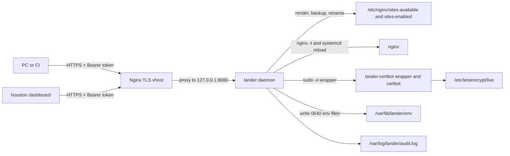
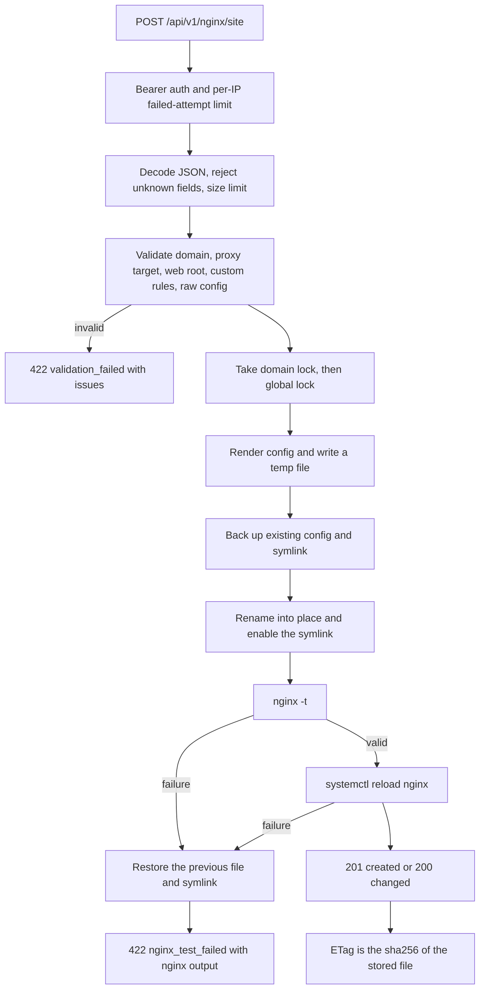
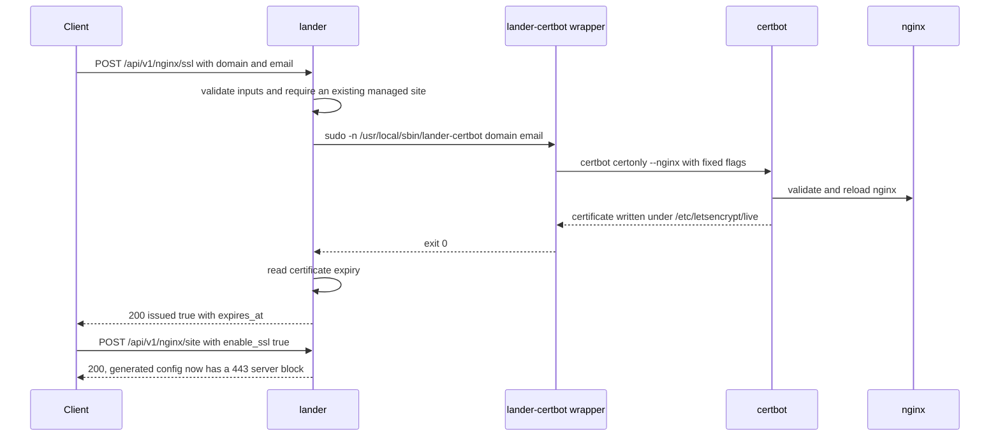

# lander

VPS daemon for the ORBIT Suite: it manages Nginx virtual hosts, TLS certificates and application env files behind a local, bearer-token-authenticated REST API. It works standalone; the other ORBIT tools only use its HTTP API.

Part of ORBIT Suite: [blackbox](https://github.com/yogaagungk/blackbox) · [payload](https://github.com/yogaagungk/payload) · [houston](https://github.com/yogaagungk/houston) · [orbit-suite docs](https://github.com/yogaagungk/orbit-suite)

Key features:

- Creates, updates and deletes managed Nginx vhosts with strict validation and an atomic apply pipeline (`nginx -t` then reload, automatic rollback on failure).
- Issues and tracks Let's Encrypt certificates through a fixed root-owned certbot wrapper; the 443 server block is generated after a certificate exists.
- Stores write-only per-app env files that `blackbox sync --target lander` can update; values are never returned or logged.
- Exposes host telemetry (CPU, memory, Nginx state, uptime) for the houston dashboard.
- No shell: fixed binaries and argument slices, per-domain locks, an audit log, and constant-time bearer-token auth with a failed-attempt rate limit.

## Problem and where it runs

Managing Nginx and certificates by hand on a self-hosted VPS is error-prone: one bad config can take every site down, and scripts that run `sed` or a shell usually end up with root code execution. lander turns that work into a small, validated API that a local CLI or the houston dashboard can call safely.

lander runs **on the VPS** as a systemd service, normally bound to `127.0.0.1:8080` and published by a TLS Nginx vhost (or reached through an SSH tunnel). It is Linux-only: it needs Nginx, certbot, systemd and a dedicated unprivileged `lander` user.

## Architecture



### Create-site request flow



### Certificate flow



## Quick start

Requirements: the Go toolchain pinned in `go.mod`, plus Nginx, certbot and systemd on the target host.

```sh
make build          # bin/lander
make test           # go test -race -count=1 ./...
make vet
make lint           # golangci-lint
```

Minimal configuration (install as `/etc/lander/lander.env`, mode `0600`):

```sh
LANDER_SECRET_TOKEN="$(openssl rand -hex 32)"
LANDER_LISTEN_ADDR=127.0.0.1:8080
LANDER_SUDO=true
```

On a PC the daemon starts, but `/healthz` returns 503 `degraded` until nginx is active under systemd (on a PC without nginx it stays degraded):

```sh
LANDER_SECRET_TOKEN="$(openssl rand -hex 32)" ./bin/lander
curl -s http://127.0.0.1:8080/healthz
```

Example output (values are example data):

```text
{"time":"2026-11-07T10:00:00Z","level":"INFO","msg":"lander listening","addr":"127.0.0.1:8080","version":"dev"}
{"status":"degraded","version":"dev","nginx_active":false}
```

The site commands below run on the VPS after `make install-systemd` and a valid `/etc/lander/lander.env`. On a PC, `/etc/nginx/sites-available` is normally not writable and `POST /api/v1/nginx/site` fails.

Create a site and inspect it:

```sh
curl -s -X POST http://127.0.0.1:8080/api/v1/nginx/site \
  -H "Authorization: Bearer $LANDER_SECRET_TOKEN" \
  -H 'Content-Type: application/json' \
  -d '{"domain":"app.example.com","proxy_target":"http://127.0.0.1:3000"}'
```

Example response (`201 Created`, example data):

```json
{"domain":"app.example.com","changed":true,"reloaded":true,"etag":"6f1c2a9d8e4b7c3a5f0d1e2b3c4d5e6f7a8b9c0d1e2f3a4b5c6d7e8f9a0b1c2d"}
```

Issue a certificate, then re-apply with TLS enabled:

```sh
curl -s -X POST http://127.0.0.1:8080/api/v1/nginx/ssl \
  -H "Authorization: Bearer $LANDER_SECRET_TOKEN" \
  -H 'Content-Type: application/json' \
  -d '{"domain":"app.example.com","email":"admin@example.com"}'

curl -s -X POST http://127.0.0.1:8080/api/v1/nginx/site \
  -H "Authorization: Bearer $LANDER_SECRET_TOKEN" \
  -H 'Content-Type: application/json' \
  -d '{"domain":"app.example.com","proxy_target":"http://127.0.0.1:3000","enable_ssl":true}'
```

Example certificate output (example data):

```json
{"domain":"app.example.com","issued":true,"expires_at":"2027-02-05T09:59:59Z"}
```

Health and telemetry:

```sh
curl -s http://127.0.0.1:8080/healthz
curl -s -H "Authorization: Bearer $LANDER_SECRET_TOKEN" http://127.0.0.1:8080/api/v1/system/stats
```

```json
{"status":"ok","version":"dev","nginx_active":true}
{"cpu_usage":4.21,"memory_usage":37.6,"nginx_active":true,"uptime":864000}
```

## Usage reference

All `/api/v1/*` routes require `Authorization: Bearer <LANDER_SECRET_TOKEN>`. Errors use `{"error":{"code","message","request_id"}}`; validation errors add an `issues` array. `GET /healthz` is public.

| Method | Path | Purpose |
| --- | --- | --- |
| GET | `/healthz` | Liveness; 200 when Nginx is active, 503 `degraded` otherwise |
| GET | `/api/v1/system/stats` | CPU, memory, Nginx state and uptime |
| GET | `/api/v1/nginx/sites` | Managed site summaries |
| GET | `/api/v1/nginx/site?domain=` | Structured config, `raw_config`, `etag` |
| POST | `/api/v1/nginx/site` | Create or update a site; honours `If-Match` |
| DELETE | `/api/v1/nginx/site?domain=` | Remove a managed site and reload (204) |
| POST | `/api/v1/nginx/validate` | Render and dry-run `nginx -t` without applying |
| POST | `/api/v1/nginx/ssl` | Issue or renew a certificate through the wrapper |
| POST | `/api/v1/env` | Write app env vars in `merge` (default) or `replace` mode |

`POST /api/v1/nginx/site` is idempotent: identical content returns 200 with `changed:false`; a new site returns 201. The response `ETag` is the sha256 of the stored file, so a client can send it back as `If-Match` and receive `409 conflict` if someone else changed the site first.

`POST /api/v1/nginx/ssl` only issues the certificate. Re-post the site with `"enable_ssl":true` to add the 443 block.

### Environment variables

| Variable | Default | Purpose |
| --- | --- | --- |
| `LANDER_SECRET_TOKEN` | — (required) | Bearer token, at least 32 bytes, no whitespace |
| `LANDER_LISTEN_ADDR` | `127.0.0.1:8080` | HTTP listen address |
| `LANDER_SITES_AVAILABLE` | `/etc/nginx/sites-available` | Managed site configs |
| `LANDER_SITES_ENABLED` | `/etc/nginx/sites-enabled` | Managed symlinks |
| `LANDER_NGINX_CONF` | `/etc/nginx/nginx.conf` | Config passed to `nginx -t -c` |
| `LANDER_NGINX_BIN` | `/usr/sbin/nginx` | Nginx binary |
| `LANDER_SYSTEMCTL_BIN` | `/usr/bin/systemctl` | systemctl binary |
| `LANDER_CERTBOT_BIN` | `/usr/local/sbin/lander-certbot` | Root-owned wrapper called as `<domain> <email>` |
| `LANDER_WEB_ROOT_BASE` | `/var/www` | Base directory allowed for static roots |
| `LANDER_LETSENCRYPT_DIR` | `/etc/letsencrypt/live` | Certificate lineage directory |
| `LANDER_ENV_DIR` | `/var/lib/lander/env` | App env files |
| `LANDER_AUDIT_LOG` | `/var/log/lander/audit.log` | Audit log path |
| `LANDER_ALLOW_PUBLIC_UPSTREAM` | `false` | Permit public `proxy_target` hosts |
| `LANDER_SUDO` | `false` | Prefix privileged commands with `sudo -n`; the unit sets `true` |
| `LANDER_TRUSTED_PROXY` | `false` | Trust `X-Forwarded-For`/`X-Real-IP` only from a loopback peer |
| `LANDER_MAX_BODY_BYTES` | `1048576` | API request body limit (1 MiB) |
| `LANDER_MAX_ENV_BODY_BYTES` | `262144` | Env request body limit (256 KiB) |
| `LANDER_AUTH_FAIL_LIMIT` | `10` | Failed auth attempts per IP per window |
| `LANDER_AUTH_FAIL_WINDOW` | `1m` | Rate-limit window |
| `LANDER_SHUTDOWN_TIMEOUT` | `10s` | Graceful shutdown timeout |
| `LANDER_COMMAND_TIMEOUT` | `15s` | Timeout for nginx/systemctl commands |
| `LANDER_VERSION` | `dev` | Version reported by `/healthz` |

## Security notes

- **No shell.** Privileged work uses `os/exec` with fixed binaries and argument slices. Input is rejected, not repaired: RFC-1123 domains, loopback/RFC1918 proxy targets by default (no link-local or metadata ranges), web roots under `LANDER_WEB_ROOT_BASE` with symlink-escape checks, allow-listed `custom_rules` and `raw_config` (parsed with an Nginx-style tokenizer).
- **Atomic apply.** Render → temp file → backup → rename → symlink → `nginx -t` → `systemctl reload nginx`. Any failure restores the previous file and symlink. Files without the `# Managed by lander` marker are never overwritten or deleted. Per-domain locks plus a global lock cover the swap through reload.
- **Least privilege.** `LANDER_SUDO=true` uses `sudo -n`; the sudoers drop-in allows only the exact forms lander uses. Never allow a wildcard `certbot ... -d *` entry: it also matches `--pre-hook` and `--deploy-hook`, which is root code execution.
- **Certbot wrapper.** certbot runs as root, so `/etc/letsencrypt/live` and `archive` are `0700`. Give the `lander` group traversal/read on the lineage directory (for example a deploy-hook that applies `chgrp lander` and `chmod 750`), otherwise certificate expiry and the 443 block stay unavailable.
- **Token handling.** Bearer tokens are compared in constant time. Ten failures per IP per minute return `429` with `Retry-After`. The token is never logged. `LANDER_SECRET_TOKEN` must be at least 32 bytes.
- **Env files.** `POST /api/v1/env` validates key names, never returns or logs values, and writes `0640` files under `LANDER_ENV_DIR`. The directory needs group `deploy` and the setgid bit; the `lander` user must be in `deploy`.

## Troubleshooting

| Symptom | Cause and fix |
| --- | --- |
| `config: LANDER_SECRET_TOKEN is required` or `must be at least 32 bytes` | Set a token of 32+ bytes without whitespace, for example `openssl rand -hex 32`. |
| `config: LANDER_LISTEN_ADDR "8090" is not host:port` | Use `host:port`, for example `127.0.0.1:8080`. |
| `401 unauthorized` | Missing or wrong `Authorization: Bearer ...` header. The token is checked before the rate limit, so a valid token is never locked out. |
| `429 rate_limited` | Too many failed auth attempts from one IP. Wait for the `Retry-After` window or set `LANDER_TRUSTED_PROXY=true` behind the loopback vhost so the real client IP is used. |
| `409 conflict`, `site changed since the supplied etag; retry` | Re-read `GET /api/v1/nginx/site` and re-apply with the new `ETag`. |
| `409 conflict`, `site config is not managed by lander` | The file lacks the `# Managed by lander` marker. Manage it through lander or choose another domain. |
| `422 nginx_test_failed` with `issues[].message` | The candidate config failed `nginx -t`; the previous config is already restored. Fix the reported line and re-apply. |
| `504 timeout`, `command timed out` | `nginx`, `systemctl` or certbot exceeded the configured timeout. Check the host load and `journalctl -u lander`. |

## Development

```sh
make test           # go test -race -count=1 ./...
make vet
make lint
make install        # /usr/local/bin/lander
make install-systemd  # binary, hardened systemd unit and env file placeholder; run as root
```

Layout:

```text
cmd/lander            entrypoint and graceful shutdown
internal/config       environment parsing and validation
internal/domain       API structs and JSON contract
internal/handler      HTTP API, bearer auth, rate limiting, error envelope
internal/service      Nginx rendering, validation, apply/rollback, SSL, env, stats
deploy/               systemd unit, installer and env example
openapi.yaml          API contract copied from the suite docs
```

The systemd unit runs lander as the unprivileged `lander` user with additional hardening. Follow `deploy/lander.env.example`; the service refuses to start with a weak or missing token.
